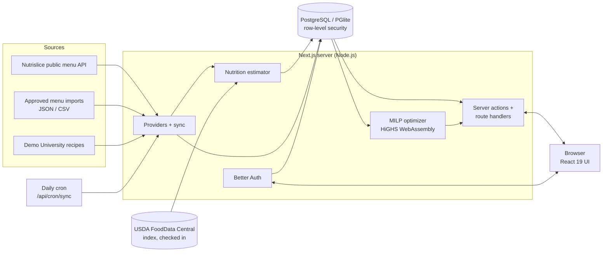

# Campus Nutrition Optimizer

A web app for college students that combines a **dining-hall menu browser**, a **food diary** and a **meal optimizer**
that plans around vitamins and minerals, not just calories. It starts with the University of Wisconsin–Madison and is
built to support more campuses.

> Independent student project. Not affiliated with, endorsed by, or sponsored by the University of Wisconsin–Madison,
> UW Housing Dining, or Nutrislice. Nutrition information is an estimate and is not medical advice.

---

## Contents

1. [What it does](#what-it-does)
2. [How it works](#how-it-works)
   - [Menu data](#1-menu-data)
   - [Nutrition estimation](#2-nutrition-estimation)
   - [The meal optimizer](#3-the-meal-optimizer)
   - [Diary and dashboard](#4-diary-and-dashboard)
   - [Accounts, privacy and security](#5-accounts-privacy-and-security)
3. [Architecture](#architecture)
4. [Tech stack](#tech-stack)
5. [Project layout](#project-layout)
6. [Getting started](#getting-started)
7. [Scripts](#scripts)
8. [Testing](#testing)
9. [Deployment](#deployment)
10. [Principles and limitations](#principles-and-limitations)
11. [Documentation](#documentation)
12. [Attribution and license](#attribution-and-license)

---

## What it does

| Area | Routes | Highlights |
|---|---|---|
| Menus | `/menus`, `/foods/[id]` | Browse by date, dining market and meal. Every value shows where it came from (official, USDA matched, USDA recipe-derived, approximate, unknown), a confidence level and a range. Menus are labeled current, cached or unavailable. Each food shows bars for its 1–3 highest nutrients. |
| Meal optimizer | `/optimizer` | A mixed-integer program picks dishes and servings across the meals you choose. Lock, replace, add and remove items, re-plan one meal or the rest of the day with a before/after preview, compare strategies, save or add to the diary. Works without an account. Anyone can set daily calorie, protein, fat and carb targets that the plan hits within a chosen tolerance. |
| Food diary | `/diary`, `/history` | Log menu items, USDA foods or custom foods. Edit servings, copy days, favorites, saved meals, planned vs eaten entries. Entries keep a snapshot of their nutrition. |
| Dashboard | `/dashboard` | Today and the past week, with confidence labels and non-judgmental wording. |
| Accounts | `/login`, `/signup`, `/settings` | Email and password (with verification and reset), optional Google sign-in, profile and preferences, data export, account deletion. |
| Universities | `/universities`, `/request-university` | Which campuses are supported and how current their data is; a "Don't see your university?" request form with spam and duplicate protection. |
| Administration | `/admin` | Manual sync where permitted, approved menu imports (JSON/CSV) with preview, re-estimation, sync history, request triage. |

The diary and the optimizer are independent: you can track what you eat without ever planning, or plan without
tracking.

---

## How it works

```
 menu sources ──► sync ──► normalized foods ──► nutrition estimator ──► database
 (Nutrislice,      │          (deduplicated      (USDA FoodData          │
  approved         │           by content hash)   Central, ranges,        ├─► menu browser
  imports, demo)   │                              confidence)            ├─► MILP meal optimizer
                   └─ staples added               ▲                      └─► diary + dashboard
                                                  └─ USDA index (checked in)
```

### 1. Menu data

UW Housing Dining publishes its menus through Nutrislice. A **provider** layer (`src/lib/menus/providers.ts`) turns
every source into the same normalized shape, so the rest of the app doesn't care where a menu came from:

- **Nutrislice sync** (`src/lib/menus/nutrislice.ts`): reads the public menu API for each dining market and meal. It
  has two modes. *Unofficial* (`NUTRISLICE_SYNC_ENABLED=true`) copies menus **without an agreement** with Nutrislice,
  whose terms don't permit automated access, so it can be blocked at any time and the interface labels these menus as
  an unofficial copy. *Authorized* (`NUTRISLICE_SYNC_AUTHORIZED=true` plus an authorization reference) is for use once a
  written agreement exists and takes precedence. Requests are throttled (1.5 s apart by default).
- **Approved imports**: an administrator can load menu files the dining operator provided (JSON or CSV) at `/admin` or
  with `npm run menus:import`. Every import records its source, where it came from and who approved it. This is the
  documented fallback whenever automatic retrieval isn't available.
- **Demo University**: a clearly labeled fictional campus whose menus are generated from USDA-based recipes, so every
  feature can be tried. It is off in production by default.

During a sync (`src/lib/menus/sync.ts`) each dish is normalized (name, serving size, station, allergens, dietary
labels, ingredient statement, published nutrition) and deduplicated with a **content hash**. An unchanged dish is
reused; a dish whose serving, nutrition, ingredients or labels change gets a new revision under the same name, and
earlier revisions stay in history. Each run is recorded with its trigger, date range, counts and warnings. Closed or
unpublished meals are shown as such: **a menu is never invented**.

**Everyday staples.** Some UW foods are served every day but never appear on the posted menu: milk (skim, 2%,
chocolate), non-fat Greek yogurt and whole fruit at every market, and sunflower seeds, spinach and eggs at the Four
Lakes Market salad bar. `src/lib/menus/staples.ts` lists them; the sync adds them to days that have a published menu, at
an "(always available)" station with a note that this site added them. Their portions are standard USDA portions and
their nutrition is a USDA estimate.

### 2. Nutrition estimation

Dining operators usually publish calories, macronutrients, sodium and a few minerals. The estimator
(`src/lib/nutrition/estimator.ts`) fills in vitamins and minerals from **USDA FoodData Central** (Foundation, SR
Legacy and FNDDS datasets, shipped as a compressed index in `data/usda/`) and is explicit about how sure it is. Every
number carries a value (or `null`), a plausible range, a provenance and a confidence.

| Provenance | Shown as |
|---|---|
| `official` | Published by the dining operator (label-rounded, so it has a small range too) |
| `usda_match` | A matching USDA record scaled to the serving |
| `usda_recipe` | Reconstructed from the ingredient list |
| `approximate` | A comparable USDA dish or partial data |
| `unknown` | Not enough information. **Never displayed or summed as zero.** |

Published values are never replaced. The estimator then tries, best first:

1. **Recipe reconstruction.** It parses the ingredient statement, matches each ingredient to USDA records, and solves a
   small optimization for ingredient amounts that follow label order, keep "2% or less" ingredients at or under 2%,
   respect realistic caps (salt, spices…) and reproduce the published calories and macros within label-rounding
   intervals (a convex quadratic program). Linear programs then find the minimum and maximum of each nutrient over every
   consistent formulation, which gives the range. Cooking losses are applied to heat-sensitive vitamins.
2. **Direct match** of the dish name to a USDA record.
3. **Comparable dish**, shown as approximate with wider ranges.

Totals add values and ranges and count how many items had no data for each nutrient, so a total can read "≈ 40% of the
reference, 3 items unknown" instead of hiding the gap. The estimator is validated against demo recipes with hidden
true compositions (`npm run estimator:validate`): 82% of ranges contained the true value, with a median error of 16%.
Details: [docs/NUTRITION_ESTIMATION.md](docs/NUTRITION_ESTIMATION.md).

### 3. The meal optimizer

The optimizer (`src/lib/optimizer/`) picks dishes and servings from the stored menus for the meals you choose. It is a
**mixed-integer linear program** solved with **HiGHS compiled to WebAssembly** (`src/lib/solver/lp.ts`) on the server.

- **Candidates.** Every item on the stored menus for the date, meal and locations, after filters for dietary pattern,
  allergens, excluded ingredients and bulk "batch" portions. Very large menus are pruned to the most useful items.
- **Decision variables.** Integer servings per item, a binary "item is on the plate", and a binary "this meal is eaten at
  this location", so **each meal is eaten at one dining location**.
- **Objective.** Minimize weighted shortfall against reference values (FDA Daily Values or Dietary Reference Intakes),
  with diminishing returns so one nutrient never crowds out the others; soft limits for sodium, saturated fat and added
  sugars; hard-to-exceed tolerable upper intake levels; and small practicality costs (few items, sensible servings,
  variety, preferred foods).
- **Uncertainty.** Goals use the conservative end of each estimate's range and limits use the pessimistic end, so
  uncertain data never inflates how well a plan does.
- **One goal.** Every plan maximizes coverage of the day's vitamin, mineral, protein and fiber references; there are
  no separate goal modes to choose from.
- **Daily targets** (optional, for anyone). Set any of calories, protein, fat and carbs. They always agree with
  `calories = 4 × protein + 9 × fat + 4 × carbs`: with three set, the fourth is calculated, and four set must add up
  exactly. Each total must land within a ±3/5/10% tolerance while being pulled toward exact. If the menus can't reach
  a target, the result says how close it can get. Signed-in users can save default targets in Settings.
- **Editing.** Lock, exclude or replace items; ask for another option (a cut excludes every plan already shown);
  re-plan from a chosen meal onward with a before/after diff; compare strategies against the same baseline. Totals update
  instantly in the browser, and saving or adding to the diary sends only the selection — the server rebuilds the plan
  from stored data, so nothing the browser sends can change nutrition values.
- **Infeasibility.** When a request can't be met, the optimizer explains which requirements conflict and what to relax
  instead of returning an empty plan.

Targets are only ever numbers the person enters; the app never suggests a calorie deficit. Details:
[docs/OPTIMIZER.md](docs/OPTIMIZER.md).

### 4. Diary and dashboard

The diary logs menu items, USDA foods or custom foods, with planned vs eaten entries, favorites and saved meals. Each
entry stores a **snapshot of its nutrition**, so later menu or estimator changes never rewrite history. The dashboard
summarizes today and the past week with the same confidence labels, and avoids scores, streaks and judgmental wording.

### 5. Accounts, privacy and security

- **Authentication** with [Better Auth](https://www.better-auth.com/): email and password with verification and reset,
  optional Google sign-in.
- **Row-level security.** Private tables (`profiles`, `diary_entries`, `favorites`, `saved_meals`, `meal_plans`) are only
  queried through `withUser()`, which switches to a restricted database role (`cno_app`) with the signed-in user's id
  set. PostgreSQL policies then make other users' rows invisible and unwritable, as a second layer behind the
  application's own filters.
- **Server-only secrets.** API keys, database credentials and tokens are read on the server; none are exposed to the
  browser.
- **Validation and abuse protection.** Server actions validate input with Zod and are rate limited per user or hashed
  client address (raw IP addresses are never stored). Menu imports are admin-only with same-origin checks and a size cap.
- **Minimal data.** Age range and sex are optional and only choose reference values. Account deletion cascades to all of
  a user's data, and data export is built in.
- Security headers (`nosniff`, frame denial, strict referrer, restricted permissions) are set in `next.config.ts`.

---

## Architecture



The app is a single **Next.js** application: pages are React Server Components, mutations are server actions, and a few
route handlers cover auth, the cron sync, admin imports, food lookup and account export. A daily job
(`/api/cron/sync`, scheduled in `vercel.json`) refreshes menus and re-estimates foods made by an older estimator.

---

## Tech stack

| Layer | Technology |
|---|---|
| Languages | TypeScript (TSX for the UI), SQL (migrations), CSS (Tailwind) |
| Framework | Next.js 16 (App Router, Cache Components, partial prefetching) on Node.js 20.9+ |
| UI | React 19, Tailwind CSS 4, shadcn/ui on Radix primitives, lucide icons, Motion, Recharts, Sonner, next-themes |
| Database | PostgreSQL 15+ in production; embedded PGlite (WebAssembly PostgreSQL) for local development and tests |
| ORM / migrations | Drizzle ORM with hand-written SQL migrations in `db/migrations/` (including RLS policies) |
| Authentication | Better Auth (email + password, optional Google OAuth), nodemailer for SMTP email |
| Optimization | HiGHS (linear and mixed-integer programming, WebAssembly) |
| Validation | Zod 4 |
| Data | USDA FoodData Central (Foundation, SR Legacy, FNDDS), Nutrislice menu API, approved CSV/JSON imports (PapaParse) |
| Testing and quality | Vitest, ESLint, TypeScript strict type checking |
| Hosting | Any Node.js host; configured for Vercel with Vercel Cron |

---

## Project layout

```
src/app/            routes, server actions, route handlers
src/components/     UI (app shell, menus, diary, optimizer, admin…)
src/db/             schema, client (withUser → row-level security), bootstrap
src/lib/menus/      providers (Nutrislice, import, demo), staples, sync, import format, freshness
src/lib/nutrition/  nutrient catalog, references (DV/DRI), USDA index, estimator, highlights
src/lib/optimizer/  candidates, filters, targets, MILP model, plan evaluation
src/lib/solver/     HiGHS wrapper
src/lib/demo/       Demo University recipes and menu generation
src/lib/universities/ campus catalog (locations, hours)
db/migrations/      SQL migrations (including RLS policies)
data/usda/          USDA reference index (raw downloads are not committed)
scripts/            sync, import, migrate, seed, USDA index build, estimator validation
docs/               in-depth documentation
tests/              unit and integration tests
```

---

## Getting started

Requirements: **Node.js 20.9 or newer** (22 LTS recommended) and npm.

```bash
npm install
cp .env.example .env.local     # then set BETTER_AUTH_SECRET (see below)
npm run dev                    # http://localhost:3000
```

With no `DATABASE_URL`, the app uses an embedded PostgreSQL (PGlite) in `.data/pglite`, runs migrations and seeds the
university catalog on first request. The USDA reference index (`data/usda/usda-index.json.gz`) is checked in; to rebuild
it see [docs/USDA_SETUP.md](docs/USDA_SETUP.md).

Generate a secret with:

```bash
node -e "console.log(require('crypto').randomBytes(32).toString('base64url'))"
```

**Menus.** Without a menu source, UW–Madison shows an honest "no menu data" notice, and the Demo University lets you try
everything. To load real UW–Madison menus, read [docs/MENU_DATA_INTEGRATION.md](docs/MENU_DATA_INTEGRATION.md), set
`NUTRISLICE_SYNC_ENABLED=true` in `.env.local`, and run `npm run menus:sync`.

**Email and admin.** In development, emails (verification, password reset) are not sent; they appear at `/dev/outbox`
unless `SMTP_URL` is set. To use `/admin`, put your verified account's email in `ADMIN_EMAILS`.

> PGlite allows one process at a time. Stop `npm run dev` before running scripts that open the database
> (`db:*`, `menus:*`, `estimator:validate`), or point both at a PostgreSQL server with `DATABASE_URL`.

All configuration is documented in [`.env.example`](.env.example).

---

## Scripts

| Command | Purpose |
|---|---|
| `npm run dev` / `build` / `start` | Next.js development server, production build, production server |
| `npm run lint` / `typecheck` / `test` | ESLint, TypeScript, Vitest (tests use an in-memory database) |
| `npm run db:migrate` / `db:seed` | Apply SQL migrations; seed the university catalog |
| `npm run menus:sync` | Sync every university where automatic retrieval is permitted, then refresh outdated estimates |
| `npm run menus:import -- --university <slug> --file <path> [--commit]` | Validate (and optionally import) an approved menu file |
| `npm run usda:download` / `usda:build-index` | Fetch USDA FoodData Central bulk files and rebuild the index |
| `npm run estimator:validate` | Measure estimator accuracy against the demo recipes ([results](docs/ESTIMATOR_VALIDATION.md)) |

---

## Testing

```bash
npm run lint && npm run typecheck && npm test
```

Vitest runs unit tests (nutrient math, estimator, parsers, optimizer model) and integration tests against a real
in-memory PostgreSQL (PGlite) that applies the actual migrations, including **row-level security tests that confirm one
user can't read or change another's records**.

---

## Deployment

The app is a standard Next.js server application with a PostgreSQL database. The steps in
[docs/DEPLOYMENT.md](docs/DEPLOYMENT.md) use Vercel and a managed PostgreSQL (Neon, Supabase, RDS…), but any Node.js
host works. In short: create a PostgreSQL 15+ database with TLS, set the environment variables from `.env.example` in
the host's encrypted settings (never in the repository), run the build, and schedule `GET /api/cron/sync` daily with
the `CRON_SECRET` bearer token.

---

## Principles and limitations

- Never invent menus, availability, ingredients, serving sizes or nutrition. **Unknown is shown as unknown, never as
  zero.**
- No allergen guarantees: labels and ingredient estimates can be wrong, and kitchens share equipment.
- No diagnosing deficiencies, no scores or streaks, no mandatory weight, and no automatic calorie deficits: calorie
  and macro targets are only ever numbers the person sets.
- Collect the minimum: age range and sex are optional and only choose reference values.
- Secrets stay on the server; every private record is protected by row-level security.
- UW–Madison menus come from an **unofficial** copy of Nutrislice's public API and can stop at any time; the app labels
  them as such and falls back to "cached" and then "no menu data" with links to the official menus.
- Staples (milk, fruit, salad-bar items) are added from a fixed list with standard USDA portions, which may differ from
  UW's actual portions.

See [docs/LIMITATIONS.md](docs/LIMITATIONS.md) for the full list.

---

## Documentation

- [USDA setup](docs/USDA_SETUP.md): datasets, rebuilding the index, licensing
- [Menu data integration](docs/MENU_DATA_INTEGRATION.md): terms-of-use findings, turning the Nutrislice sync on (unofficial or authorized), staples, imports, file format
- [Nutrition estimation](docs/NUTRITION_ESTIMATION.md): provenance, confidence, ranges ([validation results](docs/ESTIMATOR_VALIDATION.md))
- [Optimizer](docs/OPTIMIZER.md): the model, objective, constraints, daily targets and editing features
- [Deployment](docs/DEPLOYMENT.md): environment, database, cron, security checklist
- [Limitations](docs/LIMITATIONS.md): what this app cannot know

---

## Attribution and license

- Nutrient data: USDA, Agricultural Research Service, FoodData Central (public domain, CC0 1.0). https://fdc.nal.usda.gov/
- Campus photo: "View from Bascom Hill in autumn" by Yinan Chen, public domain, via Wikimedia Commons:
  https://commons.wikimedia.org/wiki/File:View_from_Bascom_Hill_in_autumn.jpg
- Menu information belongs to the dining operators that publish it.

**License:** none has been chosen yet, so by default all rights are reserved. Add a `LICENSE` file before inviting
others to reuse the code.
